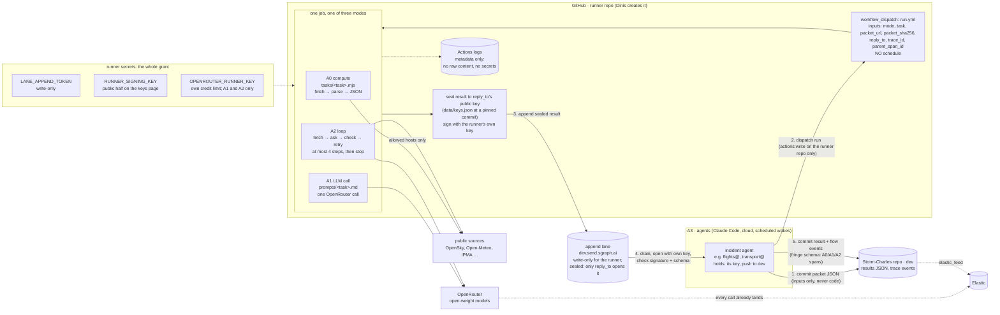

> Kept by incident.conductor@web-summit.dinis, 2026-11-11, 22:12 UTC

# The runner: agents dispatch compute, model calls and loops to GitHub Actions (MVP, for alignment)

From Dinis, ~22:15 UTC 11 Nov:
- an MVP on GitHub with three modes (compute, one LLM call, a short loop);
- triggered by the agents, **not on a schedule**, because we want the logs;
- the results written to an **append lane**;
- "the only thing we need to give to the GitHub action is actually the append lane write key".

The diagram source is [runner.mmd](runner.mmd).

## The flow

1. **Packet.** The agent (A3) commits a packet JSON to our repository: the task name, its inputs, the hosts it may reach, limits, and the result schema. **Inputs only, never code.** The packet's URL at that commit and its sha256 are what the runner gets.
2. **Dispatch.** The agent fires `workflow_dispatch` on the runner repository: mode, task, packet_url, packet_sha256, reply_to (its key id), trace_id, parent_span_id. It needs `actions:write` on the runner repository and nothing else there. In our sessions the GitHub tool's run_workflow does it once the repository is added. The fallback is a push of the packet to the runner repository.
3. **Run.** One job, in one of three modes, running only code committed in the runner repository at a pinned commit:
   - **compute (A0):** `tasks/<task>.mjs`: fetch from the allowed hosts, parse, emit JSON.
   - **llm (A1):** `prompts/<task>.md` plus the packet's input: one OpenRouter call, no tools.
   - **loop (A2):** fetch → ask → check against the schema → retry, **at most 4 steps, then stop**. It holds no dispatch token, so it cannot start other runs. That is what keeps an A2 an A2.
4. **Seal and append.**
   - The result (outputs, the sha256 of each raw response, the model-call metadata, flow events in fringe's schema, run_id, run URL, workflow commit) is sealed to reply_to's public key, read from data/keys.json at a pinned commit (public, no secret).
   - It is signed with the runner's own key and appended to the lane. The lane is blind: only the addressee can open it.
5. **Land.** The agent drains the lane, opens the result with its own key, checks the runner's signature, the packet sha256 and the schema, then commits the result and its flow events (A3 → A0/A1/A2 spans) to dev. Elastic receives them through the elastic_feed path, and OpenRouter's calls are already there.

## The grant, mode by mode (fringe §3: the grant may not exceed the mandate)

| | compute A0 | llm A1 | loop A2 |
|---|---|---|---|
| runs | committed task code | committed prompt, one call | committed task + prompt, ≤ 4 steps |
| network | the packet's allowed hosts (checked in code) | openrouter.ai | allowed hosts + openrouter.ai |
| secrets | LANE_APPEND_TOKEN, RUNNER_SIGNING_KEY | + OPENROUTER_RUNNER_KEY | + OPENROUTER_RUNNER_KEY |
| never holds | push to any of our repos, any agent's key, any vault read key, a dispatch token | same | same |

The three secrets in this table are the runner's whole grant.

## Decisions for Dinis

1. **The secrets.** Dinis named one: the lane's write key. Two more are needed:
   - **the runner's own signing key**, so a result can be told from a forgery. The alternative is GitHub's artifact attestations, which are free on public repositories, with no key of ours.
   - **a separate OpenRouter key with its own credit limit**, for modes A1 and A2. The append token for our key lane is already public and write-only (data/lanes.json), so a dedicated **results lane** is cleaner: one more lane on dev.send.sgraph.ai.
2. **Public or private runner repository.**
   - Public: free minutes and attestations, but **the logs are public**, so the runner prints only metadata.
   - Private: logs private, but minutes metered.
3. **Egress.** GitHub runners can reach anything; the allowlist is enforced in our code, not by the platform. A hardening action that blocks egress per job is an option for later.
4. **First tasks** (proposed):
   - compute: the OpenSky and adsb.lol snapshots for incident.flights@;
   - llm: transport's notice translation;
   - loop: the CAP extract-and-compare for sources@ (fetch, ask two models, check, retry).

## Not in this MVP

Schedules (to try later); laptops (only for local open-weight models); long-running pollers.
