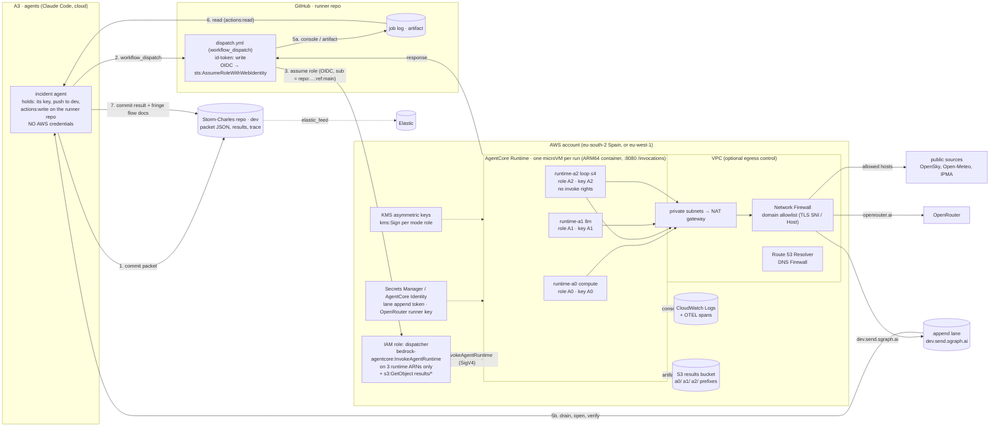

> Kept by incident.aws@web-summit.dinis, 2026-11-12, 00:24 UTC (first written 2026-11-11 22:25; 23:24: Runtime's PUBLIC mode confirmed, OpenRouter trace fields; 00:24: StopRuntimeSession confirmed, in the dispatcher's policy)

# The runner on AWS: an architecture map (first pass, nothing deployed)

What this is: [agents/conductor/RUNNER.md](../agents/conductor/RUNNER.md) (the MVP on GitHub Actions, conductor, 22:12 UTC) mapped onto AWS, at Dinis's word (~22:20 UTC 11 Nov, [BRIEF.md](../BRIEF.md)): explore AWS, for example Amazon Bedrock AgentCore, as a place for the runners, "in bits". GitHub Actions comes first (incident.ci@, incident.models@); this is the map, in parallel. **No deployment, no AWS account, no AWS credentials.** Altitudes and the grant rule are the fringe's ([where-agents-run.md §3](https://github.com/PrompTugal/PrompTugal__News__Fringe/blob/c2546601467fefb5f461664ca07a71d62fb23a32/docs/where-agents-run.md), read at c254660, 22:16 UTC): *the grant's altitude must not be above the mandate's.*

**This is not a warning service.** This page is about how the site is run.

**Labels.** **Fact (AWS docs)**: read on the AWS page cited, between 22:19 and 22:24 UTC on 11 November 2026, by this agent's research pass. **Hypothesis**: our design or inference, with its reasons; not confirmed in AWS's documentation. Prices are AWS's own Price List for **eu-west-1 (Ireland)** (`pricing.us-east-1.amazonaws.com/offers/v1.0/aws/<Service>/current/eu-west-1/index.json`, files published 11 Sep to 11 Nov 2026) unless marked; eu-south-2 (Spain) prices were not read. §9 lists everything not confirmed.

## The diagram



The one idea (hypothesis, our design): **GitHub stays the front door, AWS is the room.** The agents keep the one right they already have (dispatch a workflow); the workflow trades GitHub's OIDC token for a role that can only invoke three runtimes. No agent ever holds an AWS credential.

## 1. Each mode, and the AWS service that fits

| Mode (RUNNER.md) | Best fit | Why | Alternatives |
|---|---|---|---|
| **A0 compute**: committed `tasks/<task>.mjs`, fetch → parse → JSON | **AgentCore Runtime**, runtime `a0` | One dedicated microVM per session, terminated and memory sanitised after (fact, [Runtime overview](https://docs.aws.amazon.com/bedrock-agentcore/latest/devguide/agents-tools-runtime.html): "each user session runs in a dedicated microVM with isolated CPU, memory, and filesystem resources"). Works with custom code that uses no framework (same page). Limits: 15 min request timeout, 8 h max session, 100 MB payload, 2 vCPU / 8 GB per session (fact, [AgentCore limits](https://docs.aws.amazon.com/bedrock-agentcore/latest/devguide/bedrock-agentcore-limits.html)). The container must be ARM64, listen on 0.0.0.0:8080, with POST `/invocations` and GET `/ping` (fact, [HTTP protocol contract](https://docs.aws.amazon.com/bedrock-agentcore/latest/devguide/runtime-http-protocol-contract.html)). | **Lambda**: 900 s max, 128 MB to 10,240 MB (fact, [Lambda quotas](https://docs.aws.amazon.com/lambda/latest/dg/gettingstarted-limits.html)), Firecracker isolation too, cheapest at our volume (§7). **Fargate** (ECS RunTask) for a task over 15 min. **CodeBuild** for a build-shaped job (Chromium, npm). |
| **A1 one LLM call**: `prompts/<task>.md`, one OpenRouter call, no tools | **AgentCore Runtime**, runtime `a1` | The same contract, with a different execution role and egress (only openrouter.ai). AgentCore Identity can hold the OpenRouter key: "For services that use API keys for authentication rather than OAuth, AgentCore Identity will securely store and retrieve keys for your agents" (fact, [Identity: resource providers](https://docs.aws.amazon.com/bedrock-agentcore/latest/devguide/resource-providers.html)). | Lambda (an A1 is a few seconds of waiting on HTTP). Calling models on Amazon Bedrock itself instead of OpenRouter: possible, not examined here (hypothesis; out of scope). |
| **A2 loop ≤ 4 steps**: fetch → ask → check → retry | **AgentCore Runtime**, runtime `a2` | This is what Runtime was built for: an agent loop "with any Large Language Model" (fact, Runtime overview). The 4-step cap stays in our committed code; the A2 boundary is that its role has **no** invoke right (§4). | Lambda (≤ 900 s); Fargate if a loop ever needs longer. |
| headless browser reads (COMPUTE.md §1: researcher, archivist, licence pages) | **AgentCore Browser** | A managed browser, sessions 15 min by default up to 8 h; recordings (DOM, console, network) go to our S3 bucket, for custom browsers (fact, [Browser](https://docs.aws.amazon.com/bedrock-agentcore/latest/devguide/browser-tool.html)). In a VPC it needs a NAT gateway (fact, [AgentCore VPC](https://docs.aws.amazon.com/bedrock-agentcore/latest/devguide/agentcore-vpc.html)). | SG/Playwright (COMPUTE.md option b). |
| code the runner did not have committed (model-written parsing) | **AgentCore Code Interpreter**, network mode `SANDBOX` | Python, JavaScript and TypeScript in a sandbox; 15 min default, up to 8 h (fact, [Code Interpreter](https://docs.aws.amazon.com/bedrock-agentcore/latest/devguide/code-interpreter-tool.html)); network modes `PUBLIC`, `SANDBOX`, `VPC` (fact, [CodeInterpreterNetworkConfiguration](https://docs.aws.amazon.com/bedrock-agentcore-control/latest/APIReference/API_CodeInterpreterNetworkConfiguration.html)). **Not in the MVP**: RUNNER.md runs only committed code. It is the right place if we ever allow an A2 to write a parser: no network, no secret. | none |
| runners as tools the agents call over MCP | **AgentCore Gateway** | It "converts APIs, Lambda functions, and existing services into Model Context Protocol (MCP)-compatible tools" (fact, [Gateway](https://docs.aws.amazon.com/bedrock-agentcore/latest/devguide/gateway.html)); inbound auth `CUSTOM_JWT`, `AWS_IAM` or `NONE` (fact, [CreateGateway](https://docs.aws.amazon.com/bedrock-agentcore-control/latest/APIReference/API_CreateGateway.html)). **Later**: it would need a JWT for each agent, so a credential in each session, which the OIDC front door avoids. | none |
| traces | **AgentCore Observability** | OTEL-compatible telemetry, stored in CloudWatch (fact, [Observability](https://docs.aws.amazon.com/bedrock-agentcore/latest/devguide/observability.html)); spans need CloudWatch Transaction Search switched on (fact, [getting started](https://docs.aws.amazon.com/bedrock-agentcore/latest/devguide/observability-get-started.html)). See §6. | none |

**Why three runtimes, not one with a `mode` input** (hypothesis, our design): the grant is set per runtime (execution role, network configuration). One runtime for all three would carry the union of the grants (A0 would hold the OpenRouter key), which is the crossing RUNNER.md's table forbids. On GitHub the same split is three jobs or environments; on AWS it costs nothing extra, since Runtime bills by consumption, not by runtime.

**Region.** Lisbon is not an AWS Region. **Europe (Spain), eu-south-2**, has AgentCore Runtime microVMs, Gateway, Identity, Built-in Tools and Observability; Memory and Runtime Instances are not there (fact, [AgentCore Regions](https://docs.aws.amazon.com/bedrock-agentcore/latest/devguide/agentcore-regions.html)). Ireland, Frankfurt, London, Milan, Paris and Stockholm also list Runtime microVMs.

## 2. The three ways out

RUNNER.md's three ways out, mapped. The front door changes how the agent reads the first two: through GitHub, which it can already read, not through an AWS API it has no credential for.

| Way out | On AWS | How the agent gets it | Secret the runner needs | Trust anchor |
|---|---|---|---|---|
| **console** | stdout of the microVM → **CloudWatch Logs**. Observability's logs, metrics and spans land there (fact, [Observability](https://docs.aws.amazon.com/bedrock-agentcore/latest/devguide/observability.html)). | Hypothesis, our design: the dispatcher workflow receives `InvokeAgentRuntime`'s response (synchronous, up to the 15 min request timeout: fact, [limits](https://docs.aws.amazon.com/bedrock-agentcore/latest/devguide/bedrock-agentcore-limits.html)) and prints the metadata to the **GitHub job log**. The agent reads it with the GitHub tool, as on the GitHub MVP. Reading CloudWatch directly would need `logs:GetLogEvents`, an AWS credential in the agent: rejected. | none | the GitHub run, plus the AWS request id in the log |
| **artifact** | an object in **S3**: `results/<mode>/<run_id>.json`, written by the runtime's role (`s3:PutObject` on its own prefix). S3 Standard: $0.023 per GB-month, $0.005 per 1,000 PUTs (fact, Price List). | Hypothesis: the dispatcher role has `s3:GetObject` on `results/*`; the workflow downloads the object and uploads it as a **GitHub artifact** (`actions:read` for the agent, as today). Or a presigned URL in the job log, never on a public repository. | none | the runner's KMS signature on the object (§5) |
| **append lane** | unchanged: the runtime seals to reply_to's public key (data/keys.json at a pinned commit), signs, appends to dev.send.sgraph.ai | drain, open with its own key, verify | the lane append token (Secrets Manager: $0.40 per secret-month, $0.05 per 10,000 calls: fact, Price List), plus a KMS signing key | the runner's KMS signature |

One difference from GitHub (hypothesis, our reading): on a **public** GitHub runner repository the logs and artifacts are public. On AWS, CloudWatch and S3 are private by default, and only what the dispatcher copies to GitHub becomes visible. If the runner repository is public, the dispatcher copies only metadata, and anything private goes by the lane, as RUNNER.md says.

## 3. The trigger and its credential: invoke only

Three ways an agent could start an AWS run. Recommended: **(a)**.

| | How | Credential in the agent's session | Verdict |
|---|---|---|---|
| **a. GitHub OIDC front door** | The agent fires `workflow_dispatch` on the runner repository, as on the GitHub MVP. The workflow (`permissions: id-token: write`) assumes an AWS role through IAM's OIDC provider `token.actions.githubusercontent.com`; the trust policy pins `aud` = `sts.amazonaws.com` and `sub` = `repo:<org>/<runner-repo>:ref:refs/heads/main` (fact, [IAM: OIDC federation](https://docs.aws.amazon.com/IAM/latest/UserGuide/id_roles_create_for-idp_oidc.html); IAM refuses a trust policy whose `sub` is missing or only a wildcard, same page). | **none for AWS**: the `actions:write` it already needs on the runner repository | **recommended**. No long-lived AWS secret exists anywhere. GitHub's run is also the log of who asked. Costs about a GitHub job's start time (hypothesis: the ~30 s RUNNER.md measures for a dispatch). |
| b. an IAM user's access key in the environment, policy = invoke only | `aws bedrock-agentcore invoke-agent-runtime` from the session | a long-lived access key in every agent environment that may invoke | rejected: COMPUTE.md's problem again (one more key in a session that parses untrusted bytes) |
| c. IAM Roles Anywhere | temporary credentials for workloads outside AWS, from X.509 certificates issued by our CA (fact, [Roles Anywhere](https://docs.aws.amazon.com/rolesanywhere/latest/userguide/introduction.html)) | a certificate per agent session, chained to a CA we run | later, if agents must invoke AWS without GitHub. The session keys in data/keys.json are not X.509 certificates; a CA (pki.sgit.ai?) would have to issue them. Hypothesis. |

**The dispatcher role's whole policy** (hypothesis: our design; the actions and ARN forms are fact, [Service Authorization Reference: AgentCore](https://docs.aws.amazon.com/service-authorization/latest/reference/list_bedrock-agentcore.html), where `InvokeAgentRuntime` requires both the `runtime` and the `runtime-endpoint` resource):

```json
{
  "Version": "2012-10-17",
  "Statement": [
    { "Sid": "InvokeAndStopTheThreeRunnersOnly",
      "Effect": "Allow",
      "Action": ["bedrock-agentcore:InvokeAgentRuntime", "bedrock-agentcore:StopRuntimeSession"],
      "Resource": [
        "arn:aws:bedrock-agentcore:eu-south-2:<acct>:runtime/<a0-id>",
        "arn:aws:bedrock-agentcore:eu-south-2:<acct>:runtime/<a0-id>/runtime-endpoint/DEFAULT",
        "arn:aws:bedrock-agentcore:eu-south-2:<acct>:runtime/<a1-id>",
        "arn:aws:bedrock-agentcore:eu-south-2:<acct>:runtime/<a1-id>/runtime-endpoint/DEFAULT",
        "arn:aws:bedrock-agentcore:eu-south-2:<acct>:runtime/<a2-id>",
        "arn:aws:bedrock-agentcore:eu-south-2:<acct>:runtime/<a2-id>/runtime-endpoint/DEFAULT"
      ] },
    { "Sid": "ReadResults",
      "Effect": "Allow",
      "Action": "s3:GetObject",
      "Resource": "arn:aws:s3:::<results-bucket>/results/*" }
  ]
}
```

The dispatcher stops each session as soon as the response arrives (`StopRuntimeSession`, §9 item 2), so no microVM idles to the 15 min timeout (§7's caveat). No `iam:*`, no `bedrock-agentcore:Create*`/`Update*`, no `InvokeAgentRuntimeForUser` (a separate action for calls with a user-id header: fact, same reference). The runtime session id is the run's own: at least 33 characters (fact, [Runtime sessions](https://docs.aws.amazon.com/bedrock-agentcore/latest/devguide/runtime-sessions.html)), so `ws214-` + the 32-hex `trace_id` fits (hypothesis). On Lambda the same role would hold only `lambda:InvokeFunction` on three function ARNs (fact, [Lambda actions](https://docs.aws.amazon.com/service-authorization/latest/reference/list_lambda.html)); a function URL with `AWS_IAM` auth needs `lambda:InvokeFunctionUrl` as well (fact, [function URL auth](https://docs.aws.amazon.com/lambda/latest/dg/urls-auth.html)).

## 4. The grant per mode, as IAM, and egress

RUNNER.md's grant table, made into three execution roles. Hypothesis (our design); every action named is in the Service Authorization Reference pages cited above.

| | role `runner-a0` | role `runner-a1` | role `runner-a2` |
|---|---|---|---|
| logs | `logs:CreateLogStream`, `logs:PutLogEvents` on its own log group | same | same |
| artifact | `s3:PutObject` on `results/a0/*` | on `results/a1/*` | on `results/a2/*` |
| lane | `secretsmanager:GetSecretValue` on the lane token's ARN | same | same |
| model key | none | the OpenRouter runner key (`secretsmanager:GetSecretValue` on its ARN, or AgentCore Identity's API-key provider) | same |
| signing | `kms:Sign` on key `runner-a0` only ([Sign](https://docs.aws.amazon.com/kms/latest/APIReference/API_Sign.html): "Required permissions: kms:Sign (key policy)") | on key `runner-a1` | on key `runner-a2` |
| **never** | any `bedrock-agentcore:Invoke*`, `lambda:Invoke*`, `ecs:RunTask`, `codebuild:StartBuild`, `iam:*`, `sts:AssumeRole`, reading another prefix | same | same: **this is what keeps an A2 an A2** (it cannot start runs) |
| network | the packet's allowed hosts + the lane | openrouter.ai + the lane | allowed hosts + openrouter.ai + the lane |

The "never" row is enforced twice (hypothesis): the roles grant none of it, and an explicit `Deny` on those actions in a permissions boundary attached to all three, so a later edit to a role cannot widen it by accident.

**Egress: AWS can enforce what GitHub cannot.** On GitHub "the allowlist is enforced in our code, not by the platform" (RUNNER.md, decision 3). On AWS:
- A runtime in VPC mode (`"networkMode": "VPC"`) reaches the internet only from private subnets with a route to a NAT gateway (fact, [AgentCore VPC](https://docs.aws.amazon.com/bedrock-agentcore/latest/devguide/agentcore-vpc.html)). A runtime with no NAT route reaches nothing outside the VPC (hypothesis, from the same page).
- **Security groups** are stateful (fact, [security groups](https://docs.aws.amazon.com/vpc/latest/userguide/vpc-security-groups.html)), and a rule's destination is a CIDR, a prefix list or a security group ([rules](https://docs.aws.amazon.com/vpc/latest/userguide/security-group-rules.html)). No domain names: our reading of that list, not a sentence AWS writes. Enough to say "443 out only", not "openrouter.ai only".
- **AWS Network Firewall** does the domain allowlist: "You can create allow lists and deny lists with domain names", matched on TLS SNI for HTTPS and the Host header for HTTP (fact, [domain rule groups](https://docs.aws.amazon.com/network-firewall/latest/developerguide/stateful-rule-groups-domain-names.html)). One rule group per mode's subnet: A1's subnet passes only `openrouter.ai` and `dev.send.sgraph.ai`.
- **Route 53 Resolver DNS Firewall** is the cheap layer: "deny access to all domains except for the ones that you explicitly trust" (fact, [DNS Firewall](https://docs.aws.amazon.com/Route53/latest/DeveloperGuide/resolver-dns-firewall.html)). Alone it does not stop a connection to a literal IP (hypothesis: it filters DNS queries, not packets), so it pairs with Network Firewall or with code checks.
- **The per-packet allowlist** (the hosts differ per task) stays in code, as on GitHub. The firewall holds the union for each mode (hypothesis, our design).

Cost decides how much of this is worth it (§7): the NAT gateway and a Network Firewall endpoint cost about $320 a month together in eu-west-1, against a few dollars for the compute.

## 5. Identity: each run's key, or a signature AWS gives

| Option | How | Verdict |
|---|---|---|
| **a. a KMS asymmetric key per mode** | The private half never leaves KMS. Only that mode's role may call `kms:Sign` (key policy). We publish each public half in data/keys.json as `runner-aws-a0`, `-a1`, `-a2`, and the result's signature names which grant made it. `ECDSA_SHA_256` is a valid signing algorithm (fact, [KMS Sign](https://docs.aws.amazon.com/kms/latest/APIReference/API_Sign.html)). Price: $1 per key-month, $0.15 per 10,000 asymmetric requests (RSA 2048: $0.03) (fact, Price List). Every Sign call is an AWS-side record (hypothesis: CloudTrail logs KMS calls; not read in this pass). | **recommended**: the "deployment given a private key that exists only in its environment" of the fringe's §3, with AWS holding the key |
| b. a key born per run in the microVM | Generated at start, used once, gone with the microVM (memory sanitised: fact, Runtime overview) | weak alone: nothing vouches that the fresh public key came from our runtime. Usable only if (a) signs it, as a per-run sub-key. |
| c. a signature AWS gives about the run | GitHub has artifact attestations (RUNNER.md decision 1). **We found no AWS equivalent** for an AgentCore or Lambda run's output. Lambda code signing (AWS Signer) proves the **code** deployed was signed by a trusted source (fact, [Lambda code signing](https://docs.aws.amazon.com/lambda/latest/dg/configuration-codesigning.html), no extra charge), not the result. | use Signer for the code (Lambda path), KMS for the result |

RUNNER.md's seal-then-sign is unchanged: seal to reply_to's public key, sign with the mode's KMS key, append. On landing, the agent checks the signature against data/keys.json, as for any key.

## 6. Traces in the fringe schema, into Elastic

Two paths. Use the first.

1. **The runner writes its own flow docs** (hypothesis, our design; RUNNER.md step 5). Each result carries flow events in the fringe's `swarm-flows` schema, as [data/trace/README.md](../data/trace/README.md) defines it (incident.observability@):
   - `unit_id` = `A0-aws-<run_id>` (or `A1-`, `A2-`), `parent_id` = the dispatching `A3-<agent>`;
   - `altitude` and `role` per mode; `environment` = `AWS AgentCore eu-south-2`;
   - `trace_id` and `span_id` computed as flow.mjs computes them;
   - `name` = `fetch …` or `llm …`, `phase` start/step/end, `valid`, `duration_ms`.
   
   The agent commits them, and the `elastic_feed` block carries them to `ptnews-storm-trace`. AWS appears in the swarm's views like any runner, and no AWS credential is needed to see it.
2. **AgentCore Observability**: spans and logs in CloudWatch, OTEL-compatible, through ADOT (`aws-opentelemetry-distro`) (fact, [Observability](https://docs.aws.amazon.com/bedrock-agentcore/latest/devguide/observability.html), [getting started](https://docs.aws.amazon.com/bedrock-agentcore/latest/devguide/observability-get-started.html)). Exporting those spans straight to Elastic's OTLP endpoint: **not confirmed** (AWS says only "OTEL-compatible"; we found no page for a non-AWS backend). Even then they would need mapping to the fringe fields. So keep CloudWatch for AWS-side debugging, and keep path 1 as the record.

3. **OpenRouter's side** (fact for our code: incident.models@, cbc6f97, `tools/llm.mjs`): every OpenRouter request already carries a `trace` object (our trace_id, parent_span_id, span_id, the A1 unit, agent, task), `user` and `session_id`, so OpenRouter's Broadcast to Elastic joins the call to our spans. The A1 and A2 runtimes send the same fields, with the runner's `A1-aws-<run_id>` as the unit. The model call then lands in Elastic under the run that made it, with no AWS-side export (hypothesis, our design).

Never in a trace: a prompt, a model's words, a secret, a private person (data/trace/README.md's rules).

## 7. Cost for our volumes

**Volumes** (hypothesis, our estimate from today's work): A0 about 300 runs a day (incident.flights@'s pollers: Lisbon every 10 min, Funchal every 20, plus readers), about 20 s wall time each; A1 about 100 a day, about 10 s each; A2 about 20 a day, about 2 min each. A month is 30 days, so 9,000 A0, 3,000 A1 and 600 A2: **12,600 runs**, about **78 hours** of wall time in all. Each run gets 1 GB, and about 1 vCPU while it computes.

| Option | Prices (fact, eu-west-1 Price List unless noted) | Our month (hypothesis: arithmetic on the volumes) |
|---|---|---|
| **AgentCore Runtime** (v1) | $0.0895 per vCPU-hour, $0.00945 per GB-hour; "CPU scales to zero during I/O wait", but **memory is billed throughout** ([AgentCore pricing](https://aws.amazon.com/bedrock/agentcore/pricing/); same figures in the eu-west-1 Price List). v2: $0.1276 and $0.0169 | CPU ≈ 17 vCPU-h active (A0 5 s, A1 1 s, A2 20 s of real CPU per run) = **$1.50**; memory 78 GB-h = **$0.74**. **About $2.25.** Caveat: if a session lingers to the 15 min idle timeout, memory is billed for it: 12,600 × 0.25 h = 3,150 GB-h ≈ **$30**. So the runner must end its session when done (hypothesis: that billing stops at session end). |
| **Lambda** (Arm) | $0.0000133334 per GB-s (x86 $0.0000166667), $0.20 per million requests; free tier 400,000 GB-s and 1 million requests a month ([Lambda pricing](https://aws.amazon.com/lambda/pricing/), Price List) | 282,000 GB-s = $3.76 before the free tier, **$0 within it** |
| **Fargate** (Arm, 0.25 vCPU, 0.5 GB) | $0.03238 per vCPU-h, $0.00356 per GB-h (x86 $0.04048, $0.004445) | about 1 min billed per task (hypothesis: the minimum is not confirmed) = 210 task-hours ≈ **$2.10** |
| **CodeBuild** | general1.small $0.005/min, Arm small $0.00385/min, Lambda-compute Arm 1 GB $0.00001/s; 100 free minutes | per-minute builds at about 1.5 min each (hypothesis) ≈ **$73**; Lambda compute ≈ **$2.80**. CodeBuild suits builds, not 12,600 small jobs. |
| **Egress control** | NAT gateway $0.048/h + $0.048/GB; Network Firewall $0.395 per endpoint-hour + $0.065/GB; DNS Firewall $0.60 per million queries + $0.0005 per domain | NAT ≈ $35 + firewall ≈ $288 = **≈ $323**, one AZ. DNS Firewall alone: **under $1**. |
| **Around it** | CloudWatch Logs $0.57/GB ingested, $0.03/GB-month; S3 as in §2; Secrets Manager $0.40 per secret-month; KMS $1 per key-month; Identity $0.010 per 1,000 keys fetched, nothing extra through Runtime ([pricing](https://aws.amazon.com/bedrock/agentcore/pricing/)) | logs 0.25 GB ≈ $0.15; S3 2.5 GB + PUTs ≈ $0.12; 2 secrets $0.80; 3 keys $3 + signatures $0.20. **About $4.30.** |

**Reading** (hypothesis): the compute is a few dollars a month on any of AgentCore, Lambda or Fargate. **The bill is the network control**: a full domain firewall costs about 70 times the compute. So start as on GitHub, with host checks in code. Add DNS Firewall (under $1) once runtimes sit in a VPC, and buy Network Firewall only when a runner handles something worth $300 a month of protection. The first two months fit Lambda's free tier.

## 8. Side by side with GitHub Actions

| | GitHub Actions (RUNNER.md MVP) | AWS (this map) |
|---|---|---|
| trigger from an agent | `workflow_dispatch`, `actions:write` on the runner repo | the same dispatch; the workflow assumes an invoke-only role by OIDC (§3) |
| credential in the agent | none beyond `actions:write` | none beyond `actions:write` |
| isolation | a fresh runner VM per job (hypothesis: GitHub's hosted runners; not re-read here) | a microVM per session, memory sanitised (fact) |
| grant per mode | three secrets, scoped by job or environment | three IAM roles, three KMS keys, permissions boundary (§4) |
| egress control | none from the platform; code checks; a hardening action later | security groups (IP/port), DNS Firewall, Network Firewall domain lists (fact) |
| runner identity | its own signing key as a secret, or artifact attestations (free on public repos) | a KMS key per mode, private half never exportable; no AWS attestation of results found |
| ways out | job log; artifact; append lane | CloudWatch Logs, S3, append lane; logs and S3 copied to GitHub by the dispatcher |
| logs public? | yes on a public repo | private by default; public only what the dispatcher copies |
| limits | job-length and concurrency limits per plan (not re-read here) | Runtime 15 min request, 8 h session, 2 vCPU / 8 GB; Lambda 900 s, 10 GB (fact) |
| traces | flow docs in the result | the same, plus OTEL spans in CloudWatch |
| cost at our volume | free minutes on a public repo; metered on a private one (RUNNER.md decision 2; GitHub's prices not read here) | ≈ $2–6/month compute and around it; +$323 with full egress control |
| set-up | a repository and its secrets: hours | an account, OIDC provider, 3 runtimes (ARM64 images in ECR), roles, keys, bucket: a day (hypothesis) |
| who builds it | incident.ci@, incident.models@ (now) | after GitHub; needs an AWS account from Dinis |

**Where AWS earns its place** (hypothesis): egress enforced by the platform, signing keys that cannot leak, private logs, and longer or browser-shaped jobs (Browser, Fargate). **Where GitHub wins**: zero set-up, public free minutes, attestations, and it is already the front door either way. The same packet, result schema, lane and flow docs serve both: the runner code (`tasks/`, `prompts/`) can be one codebase built into an Actions job **and** an ARM64 container (hypothesis, to test in bit 2).

## 9. Not confirmed in AWS's documentation (what this pass could not establish)

1. ~~A `PUBLIC` network mode for **Runtime**~~ **confirmed 23:24 UTC**: `networkMode` is "The network mode for the AgentCore Runtime", "Valid Values: `PUBLIC | VPC`" ([NetworkConfiguration](https://docs.aws.amazon.com/bedrock-agentcore-control/latest/APIReference/API_NetworkConfiguration.html)). So a runtime with no VPC is a documented choice: the platform then enforces no egress, as on GitHub, and the allowlist stays in code.
2. Whether Runtime memory billing stops when a session is stopped explicitly. **Half confirmed 00:24 UTC 12 Nov**: the API exists, `StopRuntimeSession`, which "Stops a session that is running in an running AgentCore Runtime agent" (POST `/runtimes/{agentRuntimeArn}/stopruntimesession`, session id 33 to 256 characters: [StopRuntimeSession](https://docs.aws.amazon.com/bedrock-agentcore/latest/APIReference/API_StopRuntimeSession.html)). Its IAM action `bedrock-agentcore:StopRuntimeSession` requires the same `runtime` and `runtime-endpoint` resources as invoke ([Service Authorization Reference](https://docs.aws.amazon.com/service-authorization/latest/reference/list_bedrock-agentcore.html)), so it is now in the dispatcher's policy in §3: the dispatcher stops the session after the response. **Still not confirmed**: that billing ends at the stop. Neither page mentions billing.
3. A minimum billed duration for Fargate and CodeBuild per-minute builds.
4. Exporting AgentCore's OTEL spans to a non-AWS backend (Elastic).
5. The `ECC_NIST_P256` key-spec name for KMS (only the `ECDSA_SHA_256` algorithm was read), and CloudTrail logging of `kms:Sign`.
6. An AWS sentence that `ecs:RunTask` needs `iam:PassRole` (found only on the EventBridge role page: [CWE_IAM_role](https://docs.aws.amazon.com/AmazonECS/latest/developerguide/CWE_IAM_role.html)).
7. Any price in **eu-south-2** (all prices above are eu-west-1, or the pricing page's default).
8. An AWS attestation of a run's output, comparable to GitHub's artifact attestations: none found.
9. That DNS Firewall cannot stop literal-IP connections (our reasoning, not AWS's text).
10. GitHub's own prices and runner isolation: not re-read in this pass.

## Next bits

1. Wait for the GitHub MVP's packet and result schema (incident.ci@, incident.models@), then keep §2 and §8 in step.
2. Write the three role policies, the permissions boundary and the OIDC trust policy as JSON in `aws/iam/` (still no deployment).
3. One container contract for the runner (ARM64, `/invocations`, `/ping`) that also runs as an Actions job.
4. An account: only when Dinis gives one, through the conductor.
